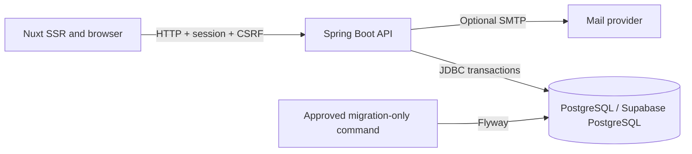

# BARNALI application architecture

See also the full [API reference](API.md), [database design](DATABASE.md), and [threat model](THREAT_MODEL.md). This describes source structure. Read-only database checks are available; the application migrations and deployment have not been run.

## Runtime boundaries

The Nuxt application renders public pages and sends browser requests to the Spring Boot API. The Java service is the authority for identity, role and permission checks, account state, community writes, analytics, moderation, and audit records. The browser does not access PostgreSQL or Supabase directly.

Trending News follows the same server boundary through an optional `TrendingNewsProvider`. No provider is configured in this workspace, so the public endpoint returns an explicit unavailable status and the UI does not invent headlines or imagery.

The API uses PostgreSQL through JDBC; Flyway runs only through the approved migration command. The last reported live state had no application roles, no barnali schema, and V1/V2 unapplied; it was not refreshed in this task. Supabase Data API and service-role credentials are not used by the browser. The event trigger enables RLS on new tables. V3 now contains source policies and narrow operations for a non-BYPASSRLS runtime, but has not been applied or PostgreSQL-validated. Keep barnali out of Supabase Data API exposed schemas. Database-owner credentials belong only in migration/admin tooling.

## Session and CSRF model

Authentication uses an opaque server-side HTTP session. The session cookie is HttpOnly, SameSite=Lax, and Secure when `SESSION_COOKIE_SECURE=true`. Spring Security rotates the session identifier at login and invalidates it on logout. Mutating API routes require a CSRF token in `X-XSRF-TOKEN`; the CSRF cookie is readable by the same-origin application, while the authentication cookie is not.

The UI's route guards are for navigation only. Every API route checks its server-side session and required permission. User registration can create only the `MEMBER` role.

For ordinary API transactions, BarnaliJdbcTransactionManager sets a transaction-local user UUID on the already-bound JDBC connection from the authenticated AppPrincipal. Pre-authentication endpoints suppress an existing session identity. The value is not taken from request data and no admin role is sent to PostgreSQL. This bridge is covered by offline tests only and is not protection from compromised API code or arbitrary SQL using the runtime credential.

## Authorization

Admin status is represented by a separate `admin_accounts` row and a server-owned role. Roles are `OWNER`, `SUPER_ADMIN`, `MODERATOR`, `ANALYTICS_VIEWER`, and `SUPPORT_ADMIN`. There is one owner row; public registration cannot set it. The owner bootstrap creates the account only when no owner exists. Delegated administrators receive single-use, expiring invitation tokens stored as hashes. Only the owner can invite, change delegated roles, or revoke an admin.

Owner-only operations use the same server permission query as other admin endpoints. That query requires an active user and rejects accounts that still need the bootstrap password change.

The owner cannot be removed, suspended, or demoted via ordinary APIs. Admin permissions are checked with Spring method security. UI visibility does not grant authorization.

## Activity and analytics

`user_activity_events` stores a user id, a small event type, and timestamp for sign-in, room join, discussion, reply, and vote activity. It intentionally omits message content, device fingerprints, and detailed client attributes. DAU/WAU/MAU count distinct users with recorded activity, not registrations. Registration and discussion chart series are SQL aggregates over their actual timestamps. No data means an empty state, not a synthetic zero trend.

## Audit log

Security-sensitive actions use `admin_audit_events`. Application code exposes no update/delete operation, and a database trigger rejects updates and deletes. This protects against normal application roles; a database owner can still alter triggers or storage, so database-level tamper resistance is not absolute. Never log passwords, session ids, invitation/reset tokens, or request bodies.

## Current limits

SMTP delivery, MFA, verified email, canonical URLs/sitemap, external monitoring, backups, and a provisioned Supabase project require implementation or operator configuration. Bookmarks, follows, personalized feeds, private messaging, blocking, notifications, and real-time delivery are not implemented; no mock live connections are presented. The application source provides no production credentials.

## Request flow

The diagram reflects the source configuration. SMTP is not configured. The read-only pooler connection is verified, but the private schema and migrations remain unprovisioned.
